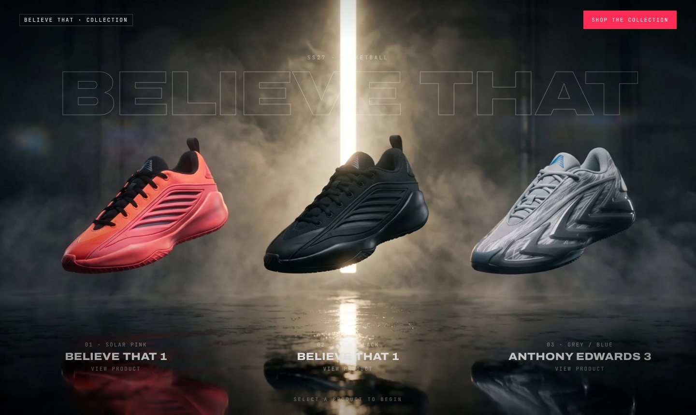
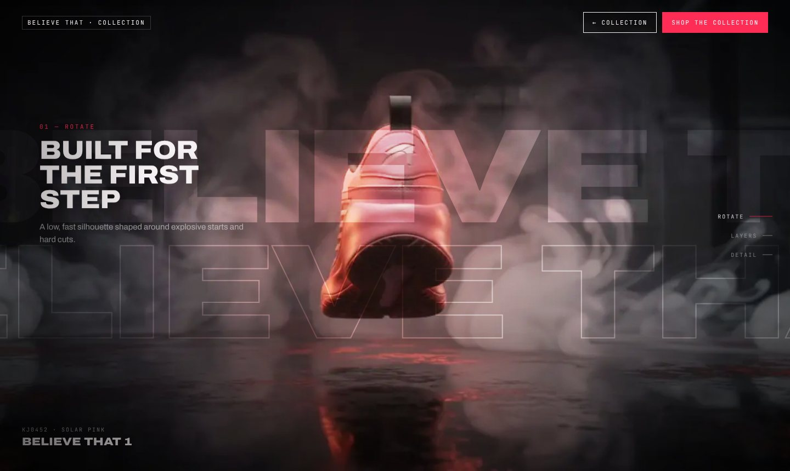
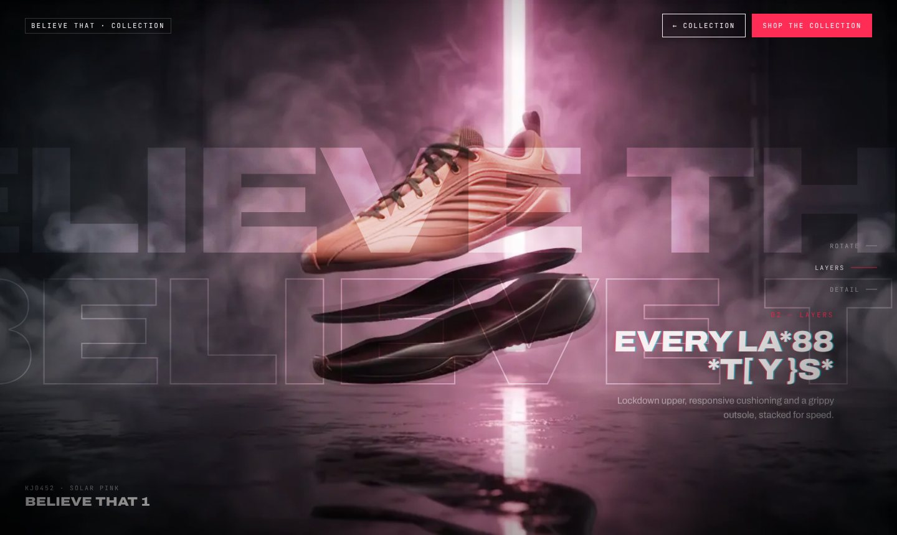
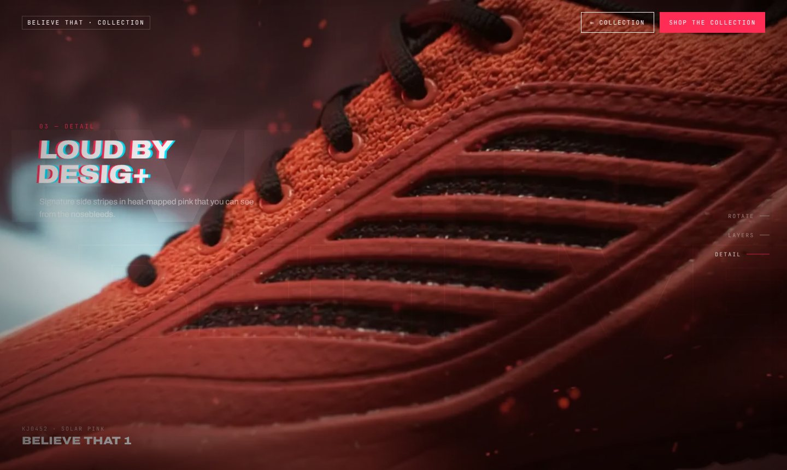
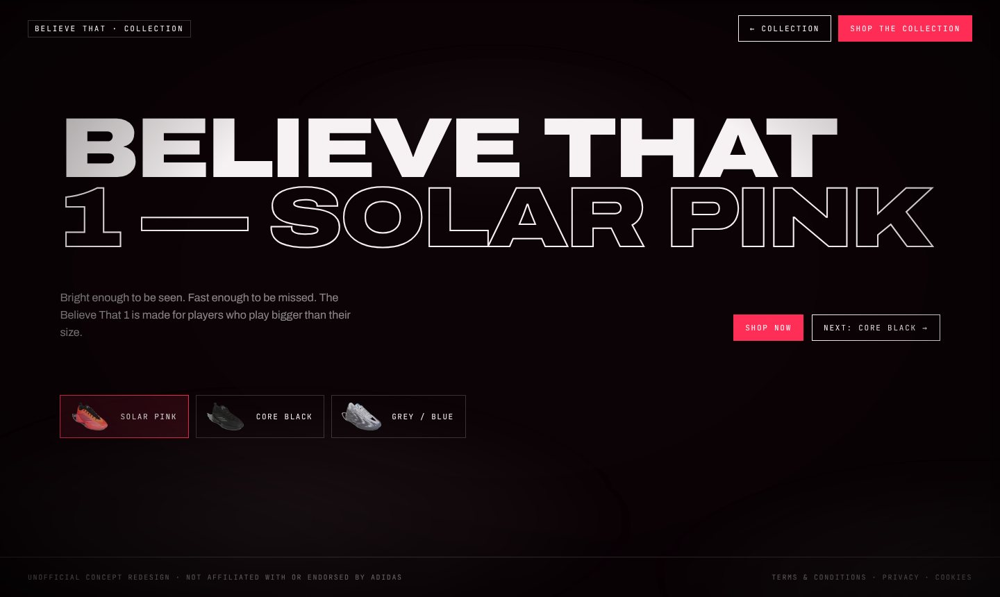
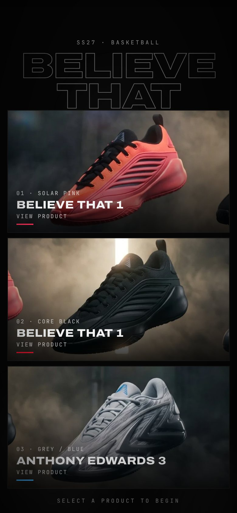
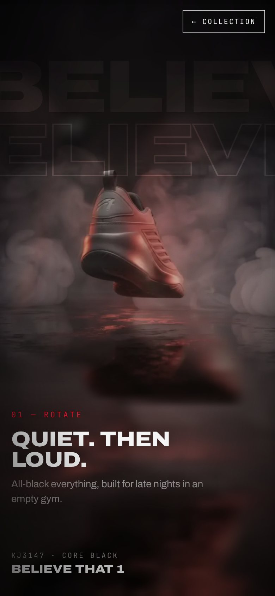

# Believe That – Cinematic Product Page (Concept)

> **Personal concept project.** This is an unofficial redesign made for my portfolio. It is not affiliated with or endorsed by adidas. Product names and designs belong to their owners.

A scroll-driven, cinematic landing page for a basketball shoe collection. The visitor picks a colorway, then scrolls through three short "scenes": the shoe **rotates**, **breaks apart into its layers**, and **zooms in** on the details. All of it is driven by the scroll position.

**Live demo:** https://cinematic.zeminmedia.workers.dev



<p>
  
  
</p>
<p>
  
  
</p>
<p>
  
  
</p>

## Why I made it

I wanted to explore how product websites like Apple's use **scroll-based video** to tell a story, and to see if I could build the same feeling with plain HTML, CSS and JavaScript, without any framework.

## Features

- **Scroll-scrubbed image sequences:** ~540 frames drawn on a `<canvas>`. Scrolling moves the video forwards and backwards, with smooth blending between frames.
- **3 scenes per product:** Rotate → Layers → Detail, each with its own animated text.
- **3 colorways:** each one changes the whole page theme (background, accent color, fog).
- **Cinematic effects:** film grain, vignette, moving fog, light flash between scenes, scrambled-text titles, color "wipe" transition between pages.
- **Mobile layout:** the collection becomes stacked cards, and the canvas re-frames the horizontal video for a vertical screen (blurred background + feathered edges).
- **Fallback animation:** if the frames are still loading, a lighter animation made from a single product photo is shown instead.
- **Keyboard shortcuts:** `1` `2` `3` to open a product, `Esc` to go back. Deep links work too (`index.html#pembe`).
- Respects `prefers-reduced-motion`.

## Tech

- HTML, CSS and vanilla JavaScript in one file
- Canvas 2D for the image sequences, `requestAnimationFrame` render loop
- WebP frames (1280×720)
- Google Fonts: Archivo (variable width), JetBrains Mono

## Project structure

```
index.html                     Page, styles and all logic
assets/
  placeholder/                 One product photo per colorway (fallback + thumbnails)
  stills/                      Collection screen and mobile card images
  <colorway>/donus/            Scene 1 frames: rotate
  <colorway>/parcalanma/       Scene 2 frames: layers
  <colorway>/yakin/            Scene 3 frames: close-up detail
screenshots/                   Images used in this README
```

To change the number of frames for a scene, edit the `FRAMES` object at the top of the script.

## Known limitations

This was a fun side project, so a few things are left rough on purpose:

- The product videos are AI-generated, so some frames show small artifacts (details of the shoe can shift between frames).
- "Shop" buttons are placeholders and do not link anywhere.
- The frames are about 19 MB in total. They load only when a product is opened, but the first scroll can stutter on a slow connection.

## Credits

Concept and art direction by **Muhammed Selim / ZeminMedia**.
Product visuals and scene videos were generated with AI (Google Gemini), then cut into frames for the scroll animation.
The code was written with AI assistance (Claude).
